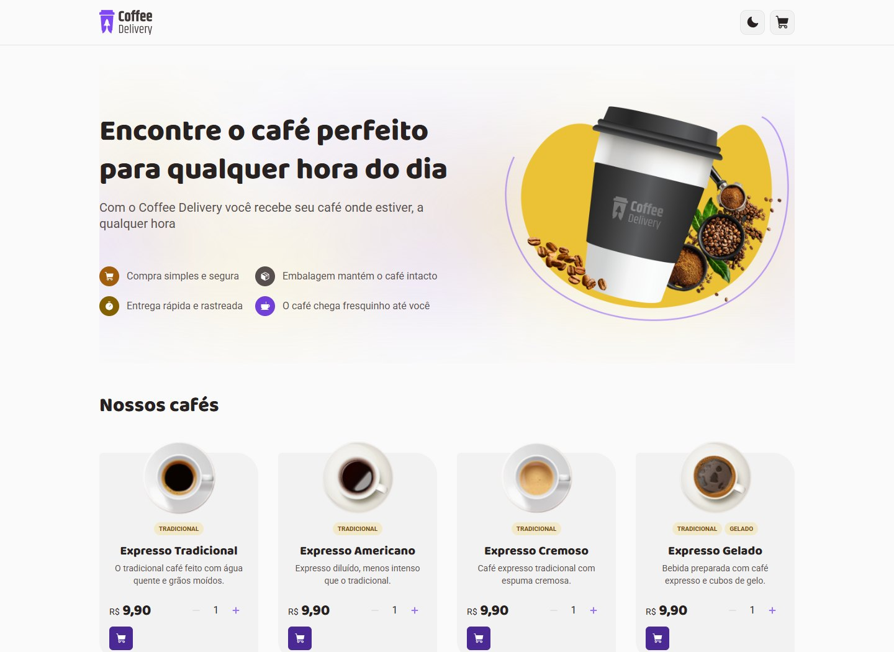
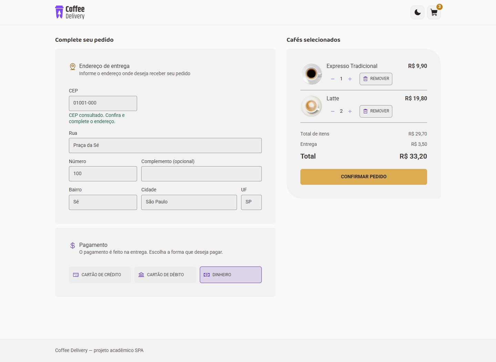
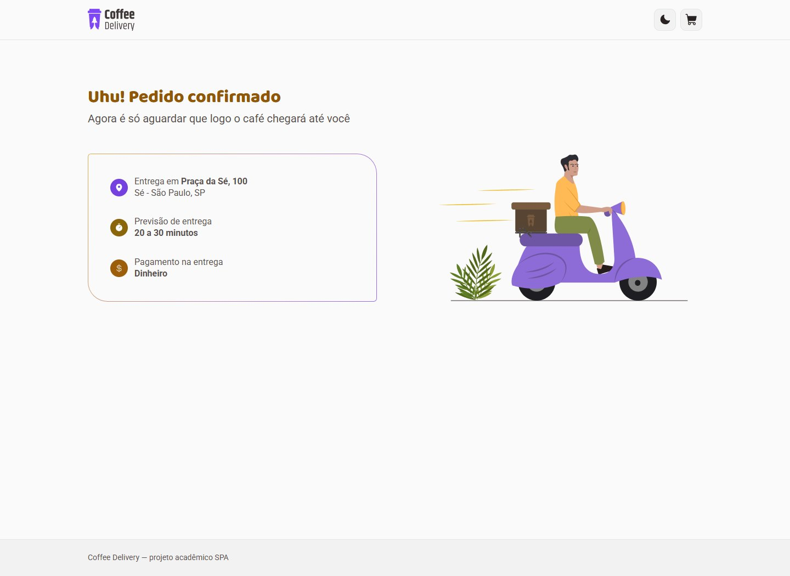
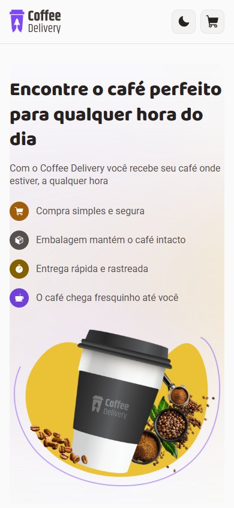
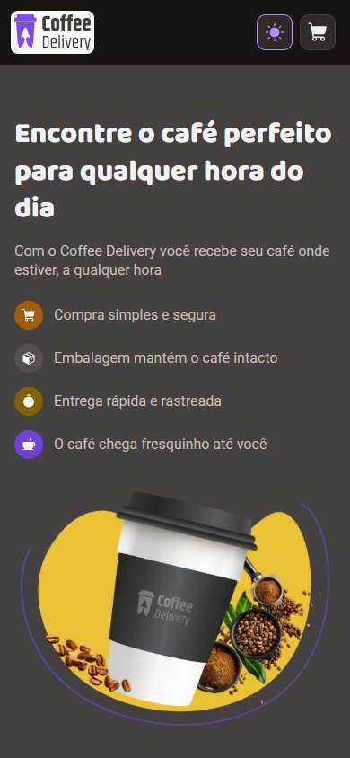

# Coffee Delivery ☕

Loja fictícia de café desenvolvida como projeto final da disciplina **Single Page Application (SPA)**. Escolha um café, ajuste o carrinho, informe o endereço e confirme um pedido de demonstração. **O site não realiza pagamentos nem entregas reais.**

**Site publicado:** [coffe-delivery-blush.vercel.app](https://coffe-delivery-blush.vercel.app/)

## Como executar

Pré-requisito: **Node.js 22.12+** em uma versão LTS atual, com npm e Git.

```bash
git clone https://github.com/wanessags/CoffeDelivery.git
cd CoffeDelivery
npm ci
npm run dev
```

Abra o endereço informado pelo Vite, normalmente [http://localhost:5173](http://localhost:5173).

| Comando | Para que serve |
|---|---|
| `npm run dev` | Inicia a aplicação em desenvolvimento. |
| `npm run lint` | Verifica o código com ESLint. |
| `npm run test` | Executa os testes com Vitest e React Testing Library. |
| `npm run build` | Verifica TypeScript e gera o site em `dist/`. |
| `npm run preview` | Abre localmente a versão de produção após o build. |

## Demonstração

1. Na Home, escolha um café e a quantidade. Adicione ao carrinho e clique no ícone do carrinho.
2. No Checkout, experimente o CEP `01001-000` e informe o número. Se a consulta falhar, os campos continuam editáveis.
3. Selecione crédito, débito ou dinheiro e clique em **Confirmar pedido**.
4. A tela de confirmação mostra o endereço e a forma de pagamento. O carrinho é esvaziado e o pedido continua visível ao recarregar a mesma aba.

### Telas

As capturas abaixo foram feitas na aplicação local. O Checkout e a Confirmação usam um endereço de demonstração e uma resposta simulada do ViaCEP.

| Home | Checkout | Confirmação |
|---|---|---|
| [](docs/evidences/home-desktop.jpg) | [](docs/evidences/checkout-desktop.jpg) | [](docs/evidences/confirmacao-desktop.jpg) |

| Home mobile — tema claro | Home mobile — tema escuro |
|---|---|
| [](docs/evidences/home-mobile.jpg) | [](docs/evidences/home-mobile-escuro.jpg) |

Outras telas mobile: [Checkout](docs/evidences/checkout-mobile.jpg) · [Confirmação](docs/evidences/confirmacao-mobile.jpg).

## Tecnologias e decisões

- **React, TypeScript e Vite:** estrutura da aplicação. **React Router:** rotas `/`, `/checkout` e `/success`.
- **Context API + `useReducer`:** o catálogo e o Checkout compartilham o carrinho. Produtos repetidos são somados, e reduzir uma linha de uma unidade para zero a remove.
- **React Hook Form + Zod + ViaCEP:** validação e consulta de endereço, com pagamento fictício. O frete é de **R$ 3,50** para carrinho não vazio, e os cálculos são feitos em centavos.
- **Persistência:** carrinho e tema em `localStorage`; confirmação em `sessionStorage`, separada do carrinho.
- **Estilos:** styled-components, CSS responsivo e ícones Phosphor. O modo claro/escuro acompanha a preferência do sistema até ser alterado pelo usuário.

## Figma, identidade visual e uso de IA

O [protótipo no Figma](https://www.figma.com/design/yGPNTA0Yczb183EikXGIiA/Coffee-Delivery-%E2%80%A2-Projeto-Final-React?node-id=2-1550) é a referência de composição, cores e tipografia (Baloo 2 e Roboto). As fotos do catálogo e a arte do banner vieram da [referência educacional da Rocketseat](https://github.com/rocketseat-education/ignite-challenge-solution-reactjs-coffee-delivery/tree/main/public/images).

A aplicação usa a [marca do copo roxo em SVG](src/assets/branding/marca-copo.svg) no cabeçalho e no favicon. O mesmo símbolo, com tons adaptados à faixa escura, aparece na estampa do copo do banner. O grão substitui o foguete da referência. A geração pela ferramenta visual ainda está pendente; veja o [registro de uso de IA](docs/AI_USAGE.md).

## Documentação

- [PRD — requisitos e critérios de aceite](docs/PRD_SPEC.md)
- [TECH — arquitetura, persistência e testes](docs/TECH_SPEC.md)
- [TASKS — etapas e validações](docs/TASKS_SPEC.md)
- [AGENTS — diretrizes do projeto](AGENTS.md)

## Hospedagem na Vercel

**Link público de produção:** [Coffee Delivery na Vercel](https://coffe-delivery-blush.vercel.app/). A Home, o Checkout e a Confirmação abrem sem login. Sem um pedido confirmado na sessão, a rota de Confirmação mostra o estado vazio.

Na [Vercel](https://vercel.com/new), entre com o GitHub, importe `wanessags/CoffeDelivery` e publique a branch `main`. O `vercel.json` já define a instalação, o build e o redirecionamento das rotas da SPA; não há variáveis de ambiente obrigatórias.
